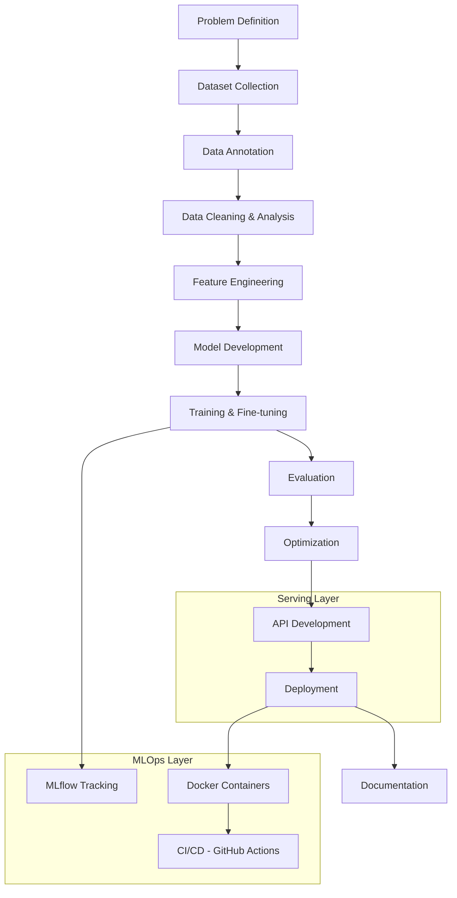

# VEXONOVA

### BUILD. INTELLIGENCE. IMPACT.

**We turn artificial intelligence into real-world products.**

*Formerly AI Builders. Same team, bigger ambition.*

**[Explore Repositories](https://github.com/AI-Builders-Iran)** · **[Meet the Team](#team--leadership)** · **[Join on Telegram](https://t.me/project_realtime)** · **[Contact Us](mailto:aibuildersiran@gmail.com)**

---

## Table of Contents

- [Introduction](#introduction)
- [Mission and Vision](#mission-and-vision)
- [Engineering Philosophy](#engineering-philosophy)
- [Technical Domains](#technical-domains)
- [Projects](#projects)
- [Technology Stack](#technology-stack)
- [Team & Leadership](#team--leadership)
- [Contributing](#contributing)
- [Future Direction](#future-direction)
- [Contact](#contact)

---

## Introduction

**AI Builders is now VEXONOVA.**

New name, same people. This is not a merger, an acquisition, or a fresh start. It is the same group of engineers, with the same open-source work and the same standards, taking a name that fits where we want to go: building more advanced, more reliable, and more impactful technology.

Everything we built as AI Builders is still ours, and it is still here. Existing repositories, links, and contact channels keep working exactly as before.

VEXONOVA is an open-source, collaboration-driven engineering organization. Students, researchers, and experienced engineers work side by side and build complete systems the way a professional team would: from defining the problem and collecting data, through training, evaluation, and deployment, to documentation that other people can actually use.

---

## Mission and Vision

> **We Build What Others Only Explain.**

There is no shortage of tutorials, and there is no shortage of theory. What we care about is the part in between: taking an idea all the way to a working system.

VEXONOVA is an AI and advanced engineering initiative focused on practical, reliable, and scalable technologies that solve real-world problems. We are not a tutorial group, a purely theoretical research community, or a conventional outsourcing shop. We research, engineer, evaluate, deploy, and document technologies that can grow into useful products.

Over the long term, we want to develop deep engineering capabilities and build increasingly sophisticated technology. We will get there in focused stages: strong fundamentals first, real projects completed, solutions validated, and reusable engineering practices in place before we reach into more advanced areas. We would rather be very good at a few things than loosely involved in many.

---

## Engineering Philosophy

Every VEXONOVA project follows the same loop:

**Learn → Build → Evaluate → Deploy → Document → Impact**

| | Stage | What it means in practice |
|---|---|---|
| 📖 | **Learn** | Understand the concepts, the technology, and the real engineering constraints before writing code. |
| 🔨 | **Build** | Turn ideas into working prototypes and practical solutions. |
| 🧪 | **Evaluate** | Test performance, reliability, limitations, and real-world usefulness, including the unflattering results. |
| 🚀 | **Deploy** | Integrate validated systems into usable applications or environments when it makes sense. |
| 📝 | **Document** | Keep documentation clear and experiments reproducible, so others can follow and verify. |
| 🎯 | **Impact** | Measure usefulness and aim at genuine problems. |

We value engineering quality, experimentation, open-source collaboration, and continuous improvement. We also hold ourselves to responsible technical claims: we say what a system does, and just as clearly what it does not.

---

## Technical Domains

### Where we work today

| Domain | Focus |
|---|---|
| 🧠 **Artificial Intelligence & Machine Learning** | Deep learning, NLP, and applied machine learning across the full model lifecycle |
| 💬 **LLM Engineering, RAG & AI Agents** | Retrieval-augmented generation pipelines, agentic workflows, and API-driven inference |
| 👁️ **Computer Vision & Intelligent Perception** | Detection, segmentation, classification, and tracking systems |
| ⚙️ **Software Engineering & AI Infrastructure** | APIs, containerization, experiment tracking, and CI/CD for reliable intelligent systems |

### Where we want to go

| Domain | Status |
|---|---|
| 🤖 **Robotics, Autonomous Systems & Intelligent Machines** | A long-term strategic interest. It is not a current product line or an existing capability. See [Future Direction](#future-direction). |

---

## Projects

### 🚧 In Progress

#### [ChemLib-AI](https://github.com/Vexonova-ai/ChemLib-AI)

An enterprise-grade Document AI system. It combines a document preprocessing pipeline with retrieval-augmented generation (RAG) and LLM-powered AI agents, so teams can understand, retrieve, and reason over large document collections automatically.

**Tech stack:** Python, RAG, LLMs, AI Agents, FastAPI

#### [TeamDocs-AI](https://github.com/Vexonova-ai/TeamDocs-AI)

A software-engineering assistant for development teams. It combines retrieval-augmented generation (RAG) over team documentation with GitHub integration through MCP and an issue-analysis agent, so engineers can get answers grounded in their own docs and repositories.

**Tech stack:** Python, RAG, LLMs, AI Agents, GitHub MCP

### ✅ Completed & Flagship Projects

#### [Safety Monitoring System](https://github.com/AI-Builders-Iran/IAI-001-Safety-Monitoring-System)

A production-grade reference project that connects Computer Vision with an LLM. YOLOv8 detection and tracking feed an 8-rule industrial safety Rule Engine covering PPE compliance, proximity, idleness, and crowd density. Events are logged through FastAPI, and a local LLM (Qwen2.5) writes daily and weekly HSE compliance reports in both Persian and English.

**Tech stack:** Python, YOLOv8, FastAPI, OpenCV, Hugging Face Transformers, Gradio, PostgreSQL, Docker, uv

#### [PCB Defect Detection](https://github.com/AI-Builders-Iran/PCB-Defect-Detection)

A two-stage Computer Vision system for finding, classifying, and tracking assembly defects on PCB boards. A board-segmentation YOLO model first crops the PCB region, then a second YOLO model scans it for defects, with ByteTrack following them across frames. Everything is exposed through a FastAPI REST API and a Streamlit dashboard, and ships as a single Docker image.

**Tech stack:** Python, YOLO (Ultralytics), OpenCV, FastAPI, Streamlit, ByteTrack, Docker
**License:** Not specified in the repository

> Repository URLs currently keep the `AI-Builders-Iran` organization path. Each repository sets its own license.

---

## Technology Stack

Every project follows the same path from problem to documentation:

| Layer | Technologies |
|---|---|
| **Language** | Python |
| **ML / DL** | PyTorch, TensorFlow, scikit-learn, XGBoost, LightGBM, Optuna |
| **Computer Vision** | OpenCV, Ultralytics, ONNX, OpenVINO |
| **LLM / NLP** | Hugging Face Transformers, LangChain, FAISS, ChromaDB |
| **Backend / API** | FastAPI, REST |
| **MLOps / Deployment** | Docker, MLflow, GitHub Actions, CUDA |
| **Data Science** | Pandas, NumPy, Matplotlib, Plotly |
| **Tooling** | Git, GitHub, Jupyter, VS Code |

---

## Team & Leadership

VEXONOVA runs on technical ownership, practical learning, code quality, and shared responsibility. Here are the people who keep it moving.

### 👑 Organizational Leadership

| Member | Title | Responsibilities |
|---|---|---|
| **Amir Mohammad Hatamzadeh** ([@hatamzadeh86](https://github.com/hatamzadeh86)) | Founder & CEO | Sets the organization's vision and direction |
| **Hossein Heydari** ([@HosseinHeydari2004](https://github.com/HosseinHeydari2004)) | Co-Founder, Technical Lead, GitHub Operations Manager | Leads technical direction and GitHub operations; drives repository management and cross-team coordination |

### 🧭 Strategic & Technical Advisory

| Member | Title | Responsibilities |
|---|---|---|
| **Farid Jabari Maleki** ([@faridjb](https://github.com/faridjb)) | Strategic & Technical Advisor | Provides strategic guidance and technical expertise to leadership; contributes to technical decision-making and long-term planning |

### 🤝 Client Relations & Technical Advisory

| Member | Title | Responsibilities |
|---|---|---|
| **samizi** ([@samiscooter](https://github.com/samiscooter)) | Technical & Client Relations Advisor | Bridges the technical team and clients; supports communication, requirements gathering, project discussions, and technical negotiations |

### 🛡️ Community Management & Executive Coordination

| Member | Title | Responsibilities |
|---|---|---|
| **Eyna Shabani** ([@Eyna-A](https://github.com/Eyna-A)) | Executive Coordinator & Community Manager | Strategic coordination, executive support, organization operations, issue/PR management, contributor support |

### 🌐 Strategic Partnerships & External Relations

| Member | Title | Responsibilities |
|---|---|---|
| **Mahsa Shadi** ([@Mahsa-Shadi](https://github.com/Mahsa-Shadi)) | Director of Strategic Partnerships | Leads strategic collaborations and partnership negotiations with companies, organizations, universities, and open-source communities |

> The full Core Team roster lives in [TEAM.md](https://github.com/AI-Builders-Iran/.github/blob/main/TEAM.md).

---

## Contributing

We work the way good engineering teams do: clear issues, focused pull requests, honest code review, and documentation that keeps up with the code. If you want to build real things with real feedback, you are welcome here.

**Ways to contribute:**
- Build or improve ML/DL models and CV pipelines
- Create, clean, or annotate datasets
- Build and document APIs
- Review pull requests and write tests
- Improve documentation or onboarding materials
- Conduct applied research
- Fix bugs and optimize performance

**How it works:**
1. Check open issues, or propose a new one describing the problem you want to solve.
2. Fork the repository and create a feature branch.
3. Follow the coding and documentation standards.
4. Open a pull request referencing the relevant issue.
5. Address review feedback from a maintainer before merge.

🔒 Found a security issue? Please do **not** open a public issue. Report it privately to [aibuildersiran@gmail.com](mailto:aibuildersiran@gmail.com).

---

## Future Direction

Today, our work is AI, computer vision, LLM systems, and the software infrastructure that makes them reliable. Further out, we are drawn to industrial robotics, intelligent machines, autonomous systems, and advanced medical AI research.

To be clear, these are directions and not announcements. We will move toward them as our fundamentals, projects, and team mature, and we will document what we build and what we have validated along the way.

---

## Contact

**Organization:** VEXONOVA (formerly AI Builders)
**Founded:** 2026
**Type:** Open-source, community-driven

| Channel | Link |
|---|---|
| GitHub | [github.com/AI-Builders-Iran](https://github.com/AI-Builders-Iran) |
| LinkedIn | [AI Builders](https://www.linkedin.com/company/ai-builders-iran/) |
| Telegram | [t.me/project_realtime](https://t.me/project_realtime) |
| Email | [aibuildersiran@gmail.com](mailto:aibuildersiran@gmail.com) |
| Website | [ai-builders-iran.github.io](https://ai-builders-iran.github.io/) |

**License:** VEXONOVA has no single organization-wide license. Licensing is set per repository (see the project list above).

---

**BUILD. INTELLIGENCE. IMPACT.**

*We Build What Others Only Explain.*

